<p align="center"></p>

<h1 align="center">MicFlow: Free Wispr Flow Alternative</h1>

<p align="center"><b>Voice typing for Mac with no word limit and no subscription.</b><br>
See your words as you speak, and have them pasted the moment you let go. English, Bengali, or both in one sentence.<br>
Also does the work of seven other Mac apps: screenshots, screen recording, text capture, a louder mic, and mouse and keyboard tools.</p>

<p align="center"><a href="https://github.com/abdulllahel/MicFlow/releases/latest"><b>⬇️ Download MicFlow for free</b></a></p>

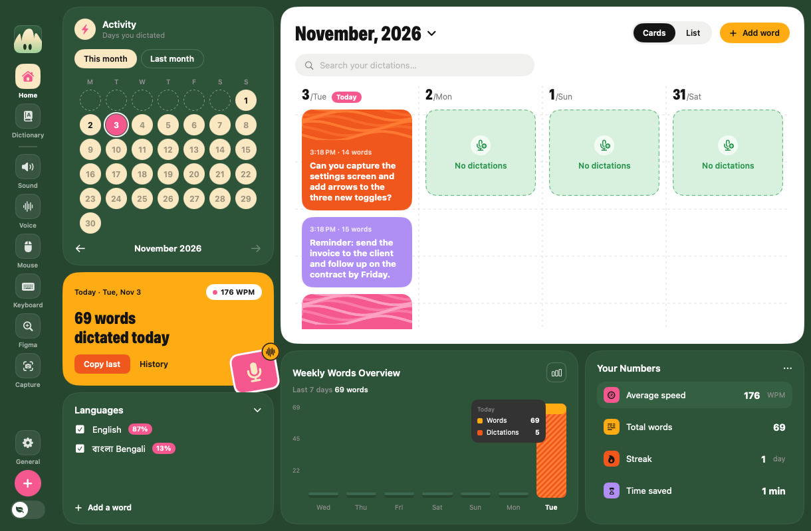

---

## Why MicFlow?

**Dictate without limits.** No weekly word cap and no subscription. Use it all day, every day.

**See it as you say it.** Your words appear on screen while you talk, and are pasted where your cursor is in under a second after you let go.

**Two languages in one sentence.** English, Bengali, or a mix, with no switching. *"Tomorrow আমরা meeting করব at 10."*

**Be heard through wireless earbuds.** Earbud microphones are quiet, so voice typing mishears you and people on calls ask you to speak up. I couldn't find a tool that turned an earbud mic up, so I built one in: MicFlow makes voice typing hear your earbuds up to 32× louder, while calls keep your normal mic (or get the boost too, if you want).

**One app instead of eight.** I built MicFlow to stop paying for and switching between a pile of Mac utilities:

| Instead of… | MicFlow does |
|---|---|
| **Wispr Flow** | Unlimited voice typing with live text |
| **CleanShot X** | Screenshots, markup, text capture (OCR), screen recording, shareable links |
| **BetterTouchTool** | One-finger Magic Mouse swipes between desktops |
| **MiddleClick** | Middle click on the Magic Mouse |
| **BetterMouse**, **LinearMouse** | Faster pointer, smooth scrolling, side buttons that switch desktops |
| **eqMac** | Speakers and microphone up to 32× louder |
| **Karabiner-Elements** | Make any key act like another |

### MicFlow and Wispr Flow side by side

| | **MicFlow** | Wispr Flow |
|---|---|---|
| Price | **Free** | Free plan, or Pro for about $15/month |
| Words you can dictate | **Unlimited** | About 2,000 words a week on the free desktop plan; unlimited needs Pro |
| Screenshots, screen recording and OCR | **Built in** | Not included |
| Mouse, keyboard and sound tools | **Built in** | Not included |

<sub>Wispr Flow details are from its public plan information as of November 2026 and can change; check wisprflow.ai for the latest. Wispr Flow, CleanShot X, BetterTouchTool, MiddleClick, BetterMouse, LinearMouse, eqMac and Karabiner-Elements are trademarks of their owners. MicFlow isn't affiliated with any of them.</sub>

---

## Download and install

It takes about 5 minutes. You will restart your Mac twice.

**[⬇️ Download MicFlow](https://github.com/abdulllahel/MicFlow/releases/latest)** (click the file that ends in `.dmg`), then open it.

Inside you'll find the app, two installers and a **Read Me First** file with the same steps as below.

1. **Install the first sound helper.** Double-click **"1 Install BlackHole 2ch"**, click Continue, Agree and Install, type your Mac password, then click **Restart**.
   *Why?* MicFlow needs a small "hidden cable" inside your Mac to pass your louder voice to apps like Zoom. This installs that cable.
2. **Install the second sound helper.** After the restart, open the downloaded file again and do the same with **"2 Install BlackHole 16ch"**. Restart again.
   *Why?* This second cable is for making your Mac's own sound louder.
3. **Install MicFlow.** Open the downloaded file again and drag **MicFlow** onto the **Applications** folder.
4. **Open MicFlow for the first time.** Your Mac protects you from apps it doesn't know yet, so the first time it will stop MicFlow:
   - Double-click MicFlow in Applications. When the warning appears, click **Done** (not "Move to Trash").
   - Open **System Settings → Privacy & Security**, scroll down, and next to *"MicFlow was blocked"* click **Open Anyway**. Type your password and click **Open Anyway** again.
   - You only do this once.
5. **Say yes when MicFlow asks for permission.** See [Why MicFlow asks for permission](#why-micflow-asks-for-permission) below.

That's it! MicFlow now has an icon in your **Dock** (the row of apps at the bottom of the screen) and a small **microphone icon in the menu bar** (the strip at the very top of the screen, near the clock).

---

## Where to find everything

- **The Home window.** Open MicFlow like any other app: click it in the Dock, find it in Launchpad, or press **⌘ Space**, type **MicFlow** and press Return. The left side of the window has a button for each part of the app: **Home, Dictionary, Sound, Voice, Mouse, Keyboard, Figma, Capture** and **Settings**.
- **The small menu bar panel.** Click the microphone icon at the top of the screen. It has the same settings in a small panel, for quick changes.
- **Closing the window doesn't stop MicFlow.** It keeps helping you in the background. To stop it completely, choose **Quit** in the panel, or press **⌘ Q** while the window is open.

Every feature has its own **on/off switch**. When the switch is **pink**, the feature is on.

---

## Features at a glance

### 🎙️ Voice typing
1. Click where you want the text: an email, a chat, a document.
2. **Hold** your voice key (Right Control at first), **talk**, and **let go**. Your words show up as you speak and are pasted when you let go.

Your words are pasted within a second of letting go, and also copied, so you can paste them again. To set it up, open **Voice** in MicFlow and follow the steps. You can change the key there too.

**Clean-up:** about a second later, MicFlow fixes words it misheard from what the sentence means (*"I want to it food"* → *"I want to eat food"*), plus punctuation, grammar and filler words. It never rewrites a sentence. Words you've edited stay yours, and if you've already sent the message, only the clipboard gets the cleaned-up text. Add **your own instructions** for it on the Voice page.

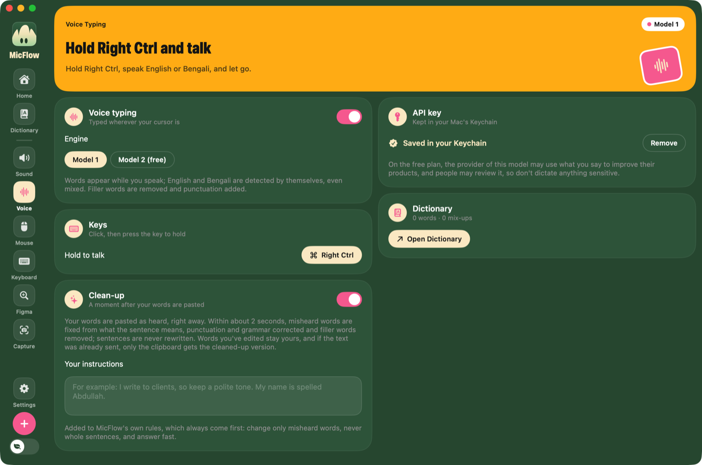

**No key yet?** Home shows two ways to set up voice typing, with what's good and what to keep in mind about each:

1. **Set it up for me with Google**: a short guide shows the Google screens you'll see and what to click, then MicFlow creates your free key in your own Google account and saves it. If Google asks you to accept its terms (one or two pages), MicFlow opens each page in the right account, shows which page you're on, and notices by itself when you're done.
2. **Create a key yourself and paste it**: MicFlow never asks for access to your Google account.

Either way, the key is saved in your Mac's Keychain only; we can't see it or use it. Every other page shows a reminder with a **Set up** button until voice typing is ready. Prefer no key at all? Model 2 needs none.

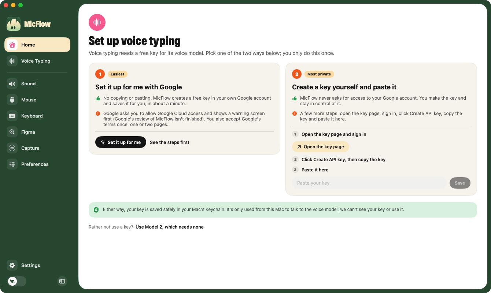

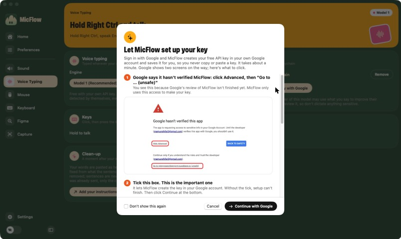

### 🎛️ Preferences
- **Your instructions:** tell clean-up who you are and how you write. *"I'm a UX designer: I talk about Figma, wireframes and user flows."*
- **My words:** brand names, jargon, local or made-up words, spelled your way. *Add "Figma" once, and it's always written "Figma".*
- **Mix-ups:** words that come out wrong. *Add "word → world", and "the whole word is watching" becomes "world", while "spell this word" stays.*


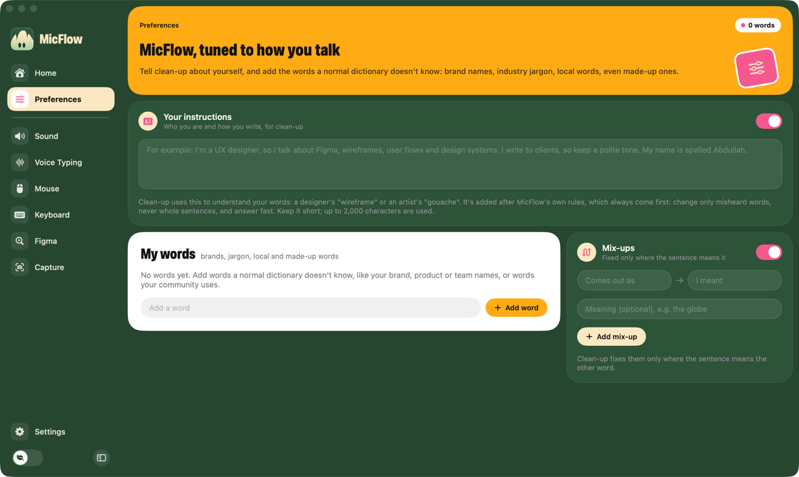

### 🏠 Home
Your voice typing at a glance: words today, a calendar of the days you dictated, a weekly chart, your speaking speed, streak and time saved, your English/Bengali split, and every recent dictation to search or copy again. Your history stays on your Mac.

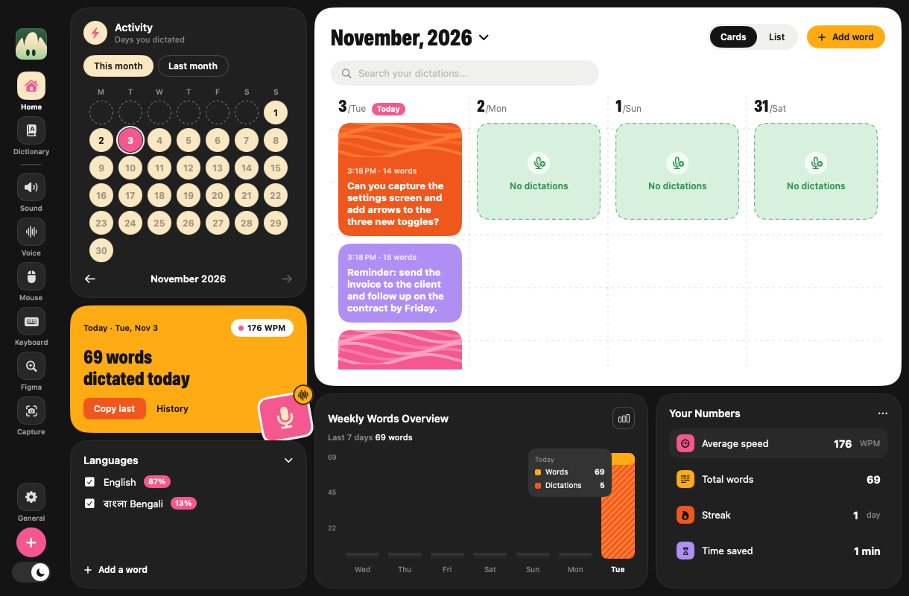

### 📸 Capture
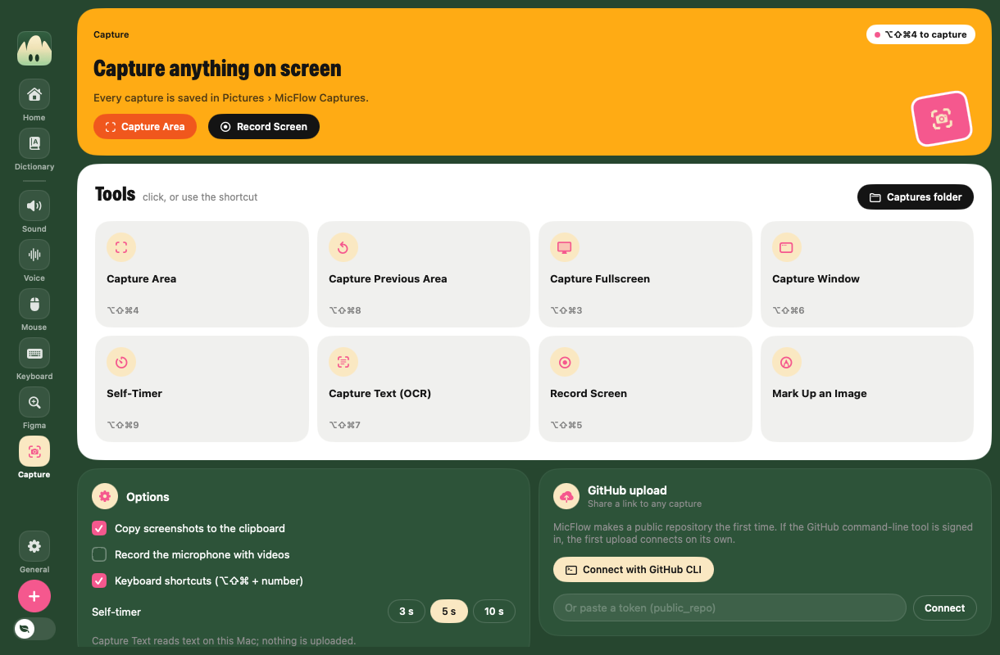

Hold **⌥ Option + ⇧ Shift + ⌘ Command** and press a number:

| Key | Tool | Example |
|---|---|---|
| **4** | Capture an area (one click takes the whole screen) | Save one chart from a long web page |
| **8** | Capture the same area again | "Before" and "after" pictures of the same spot |
| **3** | Capture the full screen | Show someone your whole desktop |
| **6** | Capture one window | Just your browser, nothing else |
| **9** | Self-timer, then the full screen | Open a menu first, then let the timer capture it |
| **7** | Copy the text in an area, even from a picture | A phone number from a photo of a poster |
| **5** | Record the screen, with your voice if you like | A short how-to video |

Change any shortcut in **Capture › Shortcuts**. After each capture, a preview appears in the corner: mark it up (arrows, boxes, text, numbers, blur), copy it, copy its text, or upload it for a private link (with your own free ImgBB key). Captures are saved in **Pictures → MicFlow Captures**.

### 🔊 Sound
- **Microphone boost:** voice typing always hears your mic louder (up to 32×), with no crackling. Great for wireless earbuds. Other apps keep your normal mic, unless you turn on the boost for all apps: *then choose **BlackHole 2ch** as the microphone in Zoom or any call app.*
- **Speaker boost:** your Mac's sound up to 32× louder. *For videos that are too quiet even at full volume.*

### 🖱️ Mouse
- **Tracking speed:** a pointer faster than macOS's fastest setting, for big screens.
- **Scroll distance** and **smooth scrolling:** scroll further per swipe, and glide instead of jump.
- **Swipe gestures** (Magic Mouse): swipe one finger to switch desktops.
- **Mouse buttons:** give any button an action: desktops, Mission Control, back/forward, copy/paste, tabs, media keys, middle click, or a shortcut of your own. Click **Add a button** and press the button.
- **Middle click** (Magic Mouse): press the middle, for example to open a link in a new tab.


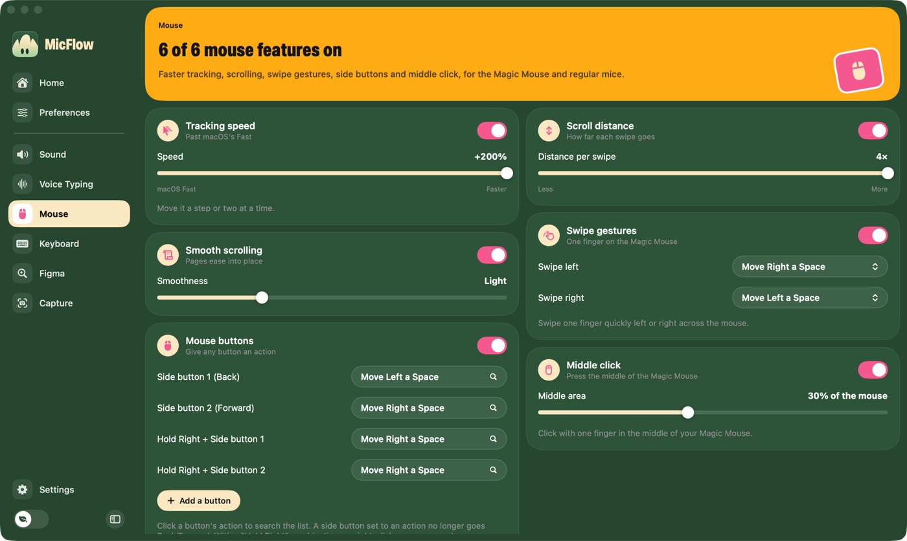

### ⌨️ Keyboard and 🎨 Figma
- **Key remapping:** make any key act like another. *Make a Windows keyboard's keys work like a Mac's.*
- **Figma zoom:** swipe up or down on the mouse to zoom the Figma canvas.

### ⚙️ Settings
- **Account (optional):** sign in with Google to save your instructions, words, mix-ups and API key, so they come back on a new Mac. No key yet? Signing in sets one up for you, in your own account.
- **Feature Requests:** vote for the ideas you want (no sign-in needed), or sign in to post one with pictures and comment. You can delete your own posts and comments.
- **Updates:** MicFlow updates itself when a new version is out. Your settings, key and permissions stay as they are.
- **About:** who makes MicFlow, and how to reach me on WhatsApp, LinkedIn or Facebook. Feature requests welcome!
- **Posts:** news and tips about MicFlow, with links that open right inside the app.

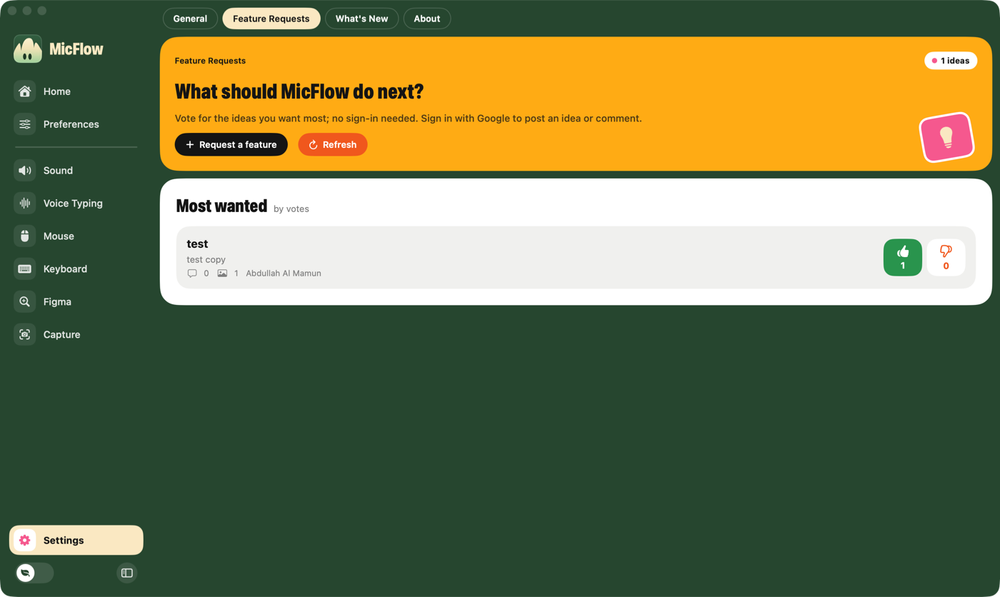

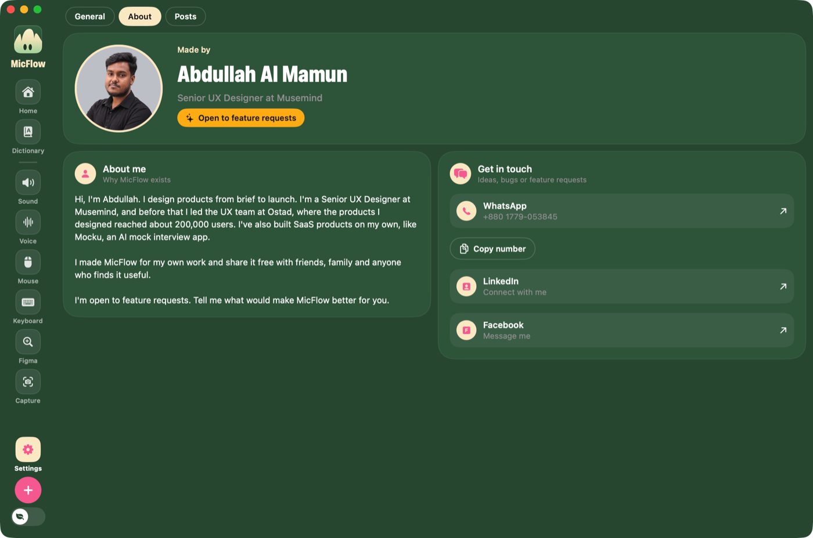

### 📋 Menu bar panel
The same settings in a small panel from the microphone icon at the top of the screen.

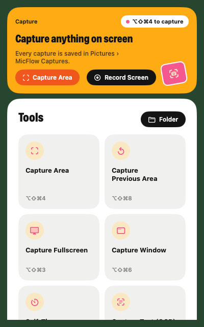

---

## Why MicFlow asks for permission

Your Mac keeps you safe by asking before an app can do certain things. MicFlow only asks for what each feature needs:

| Permission | What it's for | Example |
|---|---|---|
| **Microphone** | To hear you for voice typing and the microphone boost. | Without it, MicFlow can't hear what you say. |
| **Accessibility** | To type your words for you and to change how your mouse and keyboard behave. | Without it, MicFlow hears you but can't put the words in your email. |
| **Screen Recording** | To take pictures and videos of your screen. | Without it, your screenshots show only the desktop background. |

When your Mac asks, click **Open System Settings** and turn **MicFlow** on in the list. For Screen Recording, quit and reopen MicFlow afterwards.

---

## Your privacy

The full policy is in [PRIVACY.md](PRIVACY.md).


- **Voice typing** sends what you say to a secure cloud speech service to turn it into text. Please don't dictate passwords or very private information. The Voice page explains the details when you set it up.
- **Everything else stays on your Mac:** your dictation history, your stats, your screenshots and recordings, and the text MicFlow reads from pictures.
- **Your keys and passwords** for connected services are kept in the Mac's secure Keychain.

---

## If something doesn't work

| What you see | What to do |
|---|---|
| "BlackHole … isn't installed" in red | Run the matching installer (step 1 or 2 above) again, then restart your Mac. |
| People can't hear your boosted voice on a call | In the call app's settings, choose **BlackHole 2ch** as the microphone. |
| No sound from your speakers or headphones | In **Sound → Speakers**, pick the device you're listening on. |
| Voice typing hears you but doesn't type | Turn MicFlow on in **System Settings → Privacy & Security → Accessibility**. If it's already on, turn it off and on again. |
| Voice typing shows an error | Open the **Voice** page and read the message there; it says what to fix. |
| Screenshots show only the desktop background | Turn MicFlow on in **System Settings → Privacy & Security → Screen & System Audio Recording**, then quit and reopen MicFlow. |
| Key remaps don't work | If the app Karabiner-Elements is installed, quit it or remove it. |
| The pointer is too fast | Move **Mouse → Tracking speed** back to the left, or turn it off. |

---

## Uninstall

1. Quit MicFlow (menu bar icon → **Quit**).
2. Drag **MicFlow** from Applications to the Trash.
3. To remove the two sound helpers too: in Finder choose **Go → Go to Folder**, type `/Library/Audio/Plug-Ins/HAL`, and drag **BlackHole2ch.driver** and **BlackHole16ch.driver** to the Trash. Restart your Mac.

---

## For developers

You only need Apple's command-line tools (`xcode-select --install`), not the full Xcode app.

```bash
./build.sh       # builds build/MicFlow.app (Apple Silicon + Intel)
./make-dmg.sh    # also makes the disk image in dist/
```

`make-dmg.sh` takes the BlackHole installers from Homebrew (`brew install blackhole-2ch blackhole-16ch`). If your login keychain has a code-signing certificate named **"Mic Boost Local Signing"** (a self-signed one is fine), `build.sh` signs with it, so macOS keeps the app's permissions from one build to the next.

## License

MicFlow is released under the [MIT License](LICENSE).

The disk image also includes the BlackHole audio driver installers by Existential Audio Inc., free software under the GNU General Public License v3.0. Their license is included in the disk image, and their source code is at <https://github.com/ExistentialAudio/BlackHole>.
